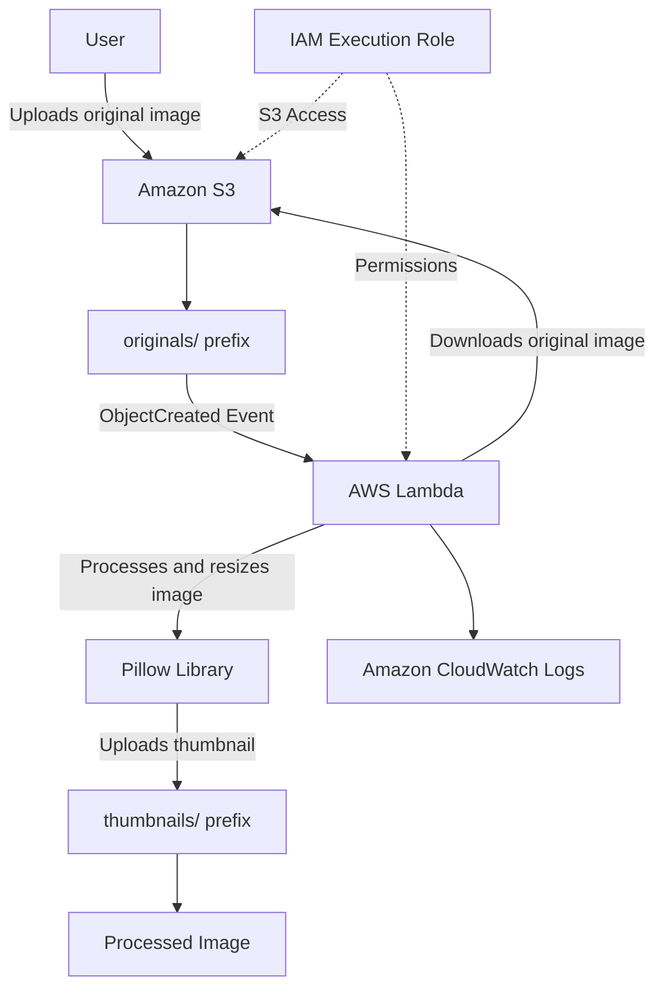

# Architecture Documentation

## 1. Architecture Overview

This project implements an event-driven, serverless image processing workflow using AWS services.

Users upload original images to an Amazon S3 bucket. An S3 event notification automatically invokes an AWS Lambda function, which processes the image using the Python Pillow library and stores the resized image in a separate S3 prefix.

## 2. Architecture Diagram

## 3. Workflow Description

1. A user uploads an image into the `originals/` prefix of the S3 bucket.
2. Amazon S3 detects the object creation event.
3. S3 sends an event notification to the Lambda function.
4. AWS Lambda retrieves the original image from S3.
5. The Pillow library processes the image:
   - Checks the image format.
   - Corrects image orientation using EXIF metadata.
   - Resizes the image while preserving its aspect ratio.
   - Optimizes the output image.
6. Lambda uploads the processed image into the `thumbnails/` prefix.
7. Amazon CloudWatch stores execution logs for monitoring and troubleshooting.

## 4. AWS Services and Components

| Component | Purpose |
|---|---|
| Amazon S3 | Stores original and processed images |
| AWS Lambda | Executes image processing automatically |
| S3 Event Notification | Triggers Lambda when an original image is uploaded |
| AWS IAM | Controls permissions for Lambda |
| Amazon CloudWatch Logs | Stores execution logs |
| Python Pillow | Performs image processing |

## 5. Security Design

- S3 Block Public Access is enabled.
- Default server-side encryption (SSE-S3) is enabled.
- Lambda uses a dedicated IAM execution role.
- The execution role follows the principle of least privilege.
- Lambda can read objects from `originals/` and write objects to `thumbnails/`.
- The Lambda resource-based policy allows invocation by the designated S3 bucket.

## 6. Event Filtering and Loop Prevention

The S3 event notification is configured to monitor objects created under the `originals/` prefix only.

The Lambda function also checks the object key and processes only files beginning with `originals/`.

Processed images are stored under `thumbnails/`, preventing the output files from triggering another image-processing execution.

## 7. Design Decisions

**Why AWS Lambda?**

Lambda provides event-driven execution without requiring permanently running servers. It is suitable for this workload because image processing starts only when an image is uploaded.

**Why Amazon S3?**

S3 provides durable object storage for both original and processed images.

**Why separate prefixes?**

Separating original and processed images improves organization and prevents recursive event processing.

**Why IAM roles?**

IAM roles provide temporary permissions to Lambda without embedding long-term AWS credentials in the application code.

## 8. Future Enhancements

Potential improvements include:

- Store image metadata in Amazon DynamoDB.
- Add structured error handling and retry strategies.
- Improve monitoring with CloudWatch metrics and alarms.
- Add an API Gateway endpoint for image-processing requests.
- Support additional image formats and configurable thumbnail sizes.

## 9. Current Project Scope

The current implementation includes Amazon S3, AWS Lambda, IAM, CloudWatch Logs, and Pillow-based image processing.

Amazon DynamoDB and API Gateway are not part of the current implementation.
