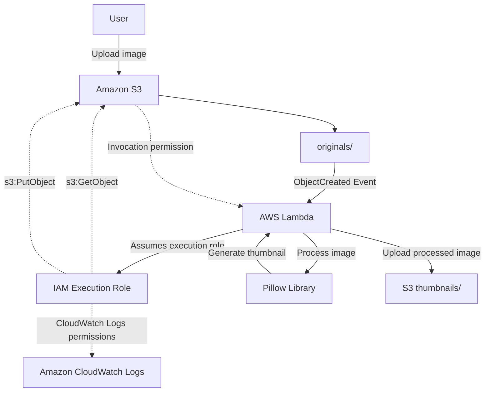

# Serverless Image Processing – Architecture Documentation

## 1. Architecture Overview

This project implements an event-driven, serverless image processing workflow using Amazon Web Services (AWS).

When a user uploads an original image to an Amazon S3 bucket, an S3 event notification automatically invokes an AWS Lambda function.

The Lambda function uses the Python Pillow library to resize the image and stores the processed thumbnail in a separate S3 prefix.

## 2. Architecture Diagram

## 3. Workflow Description

1. The user uploads an image into the `originals/` prefix of the S3 bucket.
2. Amazon S3 detects the object creation event.
3. S3 sends an event notification to the Lambda function.
4. Lambda retrieves the original image from S3.
5. The Pillow library processes the image:
   - Detects the image format.
   - Corrects image orientation using EXIF metadata.
   - Resizes the image while preserving its aspect ratio.
   - Optimizes the output image.
6. Lambda uploads the processed image into the `thumbnails/` prefix.
7. Amazon CloudWatch Logs records execution information for monitoring and troubleshooting.

## 4. AWS Services and Components

| Component | Purpose |
|---|---|
| Amazon S3 | Stores original and processed images |
| Amazon S3 Event Notifications | Triggers Lambda when an original image is uploaded |
| AWS Lambda | Executes image processing automatically |
| AWS IAM | Manages Lambda execution permissions |
| Amazon CloudWatch Logs | Stores execution logs |
| Python Pillow | Resizes and optimizes images |

## 5. Security Architecture

The project follows basic AWS security best practices:

- S3 Block Public Access is enabled.
- Default server-side encryption (SSE-S3) is enabled.
- Lambda uses a dedicated IAM execution role.
- The IAM policy follows the principle of least privilege.
- Lambda has permission to read objects from `originals/`.
- Lambda has permission to write processed images to `thumbnails/`.
- The Lambda resource-based policy allows invocation by the designated S3 bucket.

## 6. Event Filtering and Loop Prevention

The S3 event notification is configured to monitor objects created under the `originals/` prefix only.

The Lambda function also checks the object key and processes only files beginning with `originals/`.

Processed images are stored under `thumbnails/`, preventing output images from triggering another image-processing execution.

## 7. Key Architecture Decisions

### Why AWS Lambda?

Lambda provides event-driven execution without requiring permanently running servers. It is suitable for workloads that execute in response to events, such as image uploads.

### Why Amazon S3?

Amazon S3 provides scalable object storage for original and processed images.

### Why Separate S3 Prefixes?

Separating original and processed images improves organization and helps prevent recursive event processing.

### Why IAM Execution Roles?

IAM execution roles provide Lambda with temporary permissions without embedding long-term AWS credentials in the application code.

## 8. Testing and Results

The end-to-end workflow was successfully tested.

- Original images were uploaded to the `originals/` prefix.
- S3 event notifications successfully invoked Lambda.
- Lambda processed the images using Pillow.
- Resized thumbnails were successfully stored in the `thumbnails/` prefix.

Example test result:

| File Type | Approximate Size |
|---|---:|
| Original Image | 80 KB |
| Processed Thumbnail | 14 KB |

The example demonstrates a significant reduction in file size. Actual results depend on the original image dimensions, format, and content.

## 9. Future Enhancements

Potential future improvements include:

- Store image metadata in Amazon DynamoDB.
- Add structured error handling and retry strategies.
- Configure CloudWatch alarms and additional monitoring.
- Add API Gateway for API-based image processing.
- Support additional image formats and configurable thumbnail sizes.

## 10. Current Implementation Scope

The current implementation includes:

- Amazon S3
- AWS Lambda
- Amazon S3 Event Notifications
- AWS IAM
- Amazon CloudWatch Logs
- Python Pillow

Amazon DynamoDB and API Gateway are planned enhancements and are not part of the current implementation.
