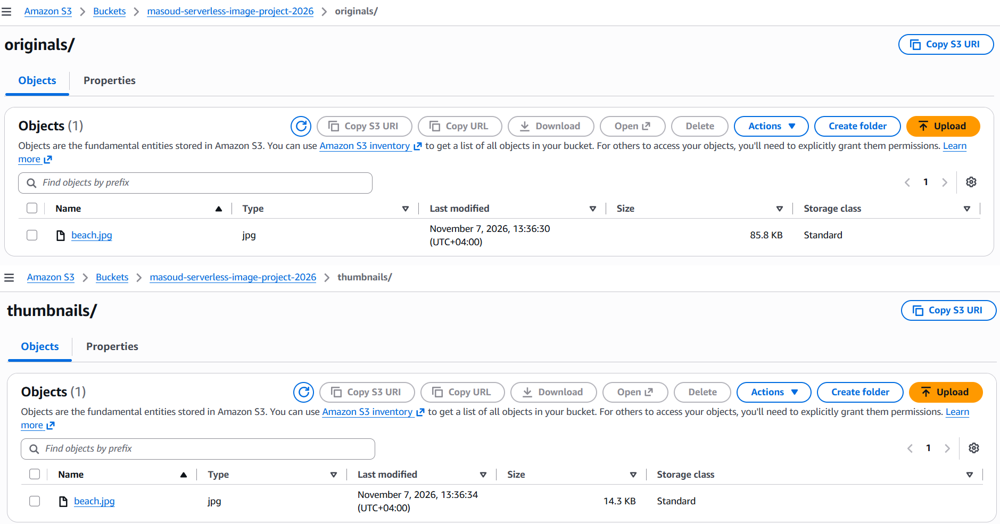

# Project Screenshots

This directory contains visual evidence of the successful deployment and testing of the Serverless Image Processing project.

## 01 — S3 Original and Thumbnail Images

**Description:**

This screenshot demonstrates the successful image processing workflow:

- The original image is stored in the `originals/` prefix.
- AWS Lambda is triggered by the S3 ObjectCreated event.
- The processed thumbnail is saved in the `thumbnails/` prefix.

**Test Result:**

| Metric | Original | Thumbnail |
|---|---:|---:|
| File name | beach.jpg | beach.jpg |
| File size | 85.8 KB | 14.3 KB |
| Creation time | 13:36:30 | 13:36:34 |

**Result:** Approximately 83.3% reduction in file size.

The thumbnail was generated successfully within approximately 4 seconds of the original image upload.
