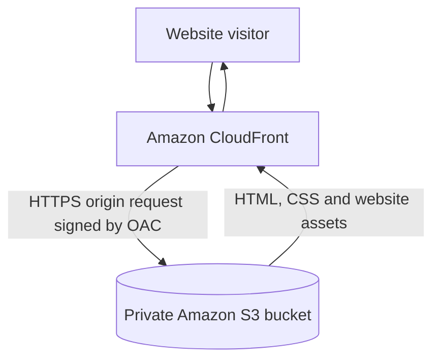

# Project 02 — Static Company Website on Amazon S3 and CloudFront

**Project type:** Hands-on AWS implementation  
**Status:** Source template prepared — AWS deployment pending  
**Date started:** 13 November 2026  
**Target architecture:** Private Amazon S3 bucket + Amazon CloudFront  
**Primary objective:** Publish a responsive static company website while learning object storage, CDN delivery, origin access control, and cost awareness.

## 1. Project Overview

This project deploys a small static company website using Amazon S3 as the origin and Amazon CloudFront as the content delivery network (CDN).

The website is intentionally static: it contains HTML and CSS and does not require a server-side application or relational database. It is therefore a suitable first deployment project before moving to dynamic application architectures such as EC2 + RDS.

The starter website is located in the `website/` directory. It contains sample company text and placeholder contact information that must be reviewed and replaced before any public or business use.

## 2. Learning Objectives

By completing this project, I aim to:

- Create and configure an Amazon S3 bucket.
- Understand the difference between an S3 bucket and an S3 static website endpoint.
- Keep the S3 bucket private and enable CloudFront access using Origin Access Control (OAC).
- Create a CloudFront distribution and configure `index.html` as the default root object.
- Test the website using the CloudFront distribution domain name.
- Understand HTTPS delivery, caching, and invalidation.
- Review AWS cost controls and remove resources safely when the lab is complete.

## 3. Target Architecture

**Request flow:** Visitor → CloudFront → private S3 origin → CloudFront edge cache → Visitor.

### AWS components

| Component | Responsibility |
|---|---|
| Amazon S3 | Stores the static website files. |
| Amazon CloudFront | Delivers cached website content to visitors through the CDN. |
| Origin Access Control (OAC) | Allows the designated CloudFront distribution to access the private S3 origin. |
| CloudFront default domain | Provides a test URL without buying or configuring a custom domain. |

## 4. Security Design

The intended configuration follows these principles:

- Keep S3 Block Public Access enabled.
- Do not make the bucket or objects publicly readable.
- Use the S3 bucket's regular origin endpoint, not the S3 static website hosting endpoint.
- Configure CloudFront Origin Access Control (OAC) and use signed origin requests.
- Allow the CloudFront distribution to read the bucket through a narrowly scoped bucket policy.
- Do not store passwords, access keys, private documents, or customer information in the public website files.
- Use the default S3 server-side encryption configuration.
- Use HTTPS for visitor access through CloudFront.

**Important:** With a private S3 origin and OAC, S3 static website hosting does not need to be enabled. CloudFront serves `index.html` as the default root object.

## 5. Cost Management

The target is to keep the lab's recurring infrastructure cost as close to zero as possible.

### Planned pricing approach

Use the CloudFront **Free flat-rate pricing plan** for the distribution, if it is available and selectable in the account.

AWS currently documents the Free plan with:
- USD $0 per month for the plan.
- 1 million requests per month.
- 100 GB of data transfer per month.
- 5 GB of Amazon S3 Standard storage credits per month in the payer account.

The Free flat-rate plan is different from the traditional CloudFront pay-as-you-go Free Tier. AWS documents that Free Tier account plans cannot use CloudFront flat-rate plans; this project is intended for a Paid Account Plan.

### Cost exclusions and cautions

The $0 target is not a promise that every possible AWS operation is free.

- S3 request charges and other S3 features may be billed separately; the 5 GB credit offsets S3 Standard storage, not every S3 charge.
- A custom domain purchased from a registrar is not included.
- Do not create a separate Route 53 hosted zone for this first deployment. Use the CloudFront-generated `cloudfront.net` domain.
- Do not create EC2, RDS, NAT Gateway, load balancers, or other resources for this static website.
- Usage allowances are not hard limits. AWS may take action such as reducing performance or requiring a pricing-structure change if usage exceeds the plan's allowances; the Free plan does not add automatic overage charges.
- Check Billing and Cost Management after deployment and monitor the CloudFront plan usage.

**Cost control checklist**
- [ ] Confirm the correct AWS account and billing plan.
- [ ] Choose CloudFront Free flat-rate plan, not a paid tier.
- [ ] Use one S3 Standard bucket with only the required site files.
- [ ] Use the CloudFront-generated domain; do not buy a domain for this lab.
- [ ] Avoid optional logging, analytics, and extra services unless their costs are understood.
- [ ] Review AWS Billing and Cost Management after deployment.
- [ ] Delete the CloudFront distribution and S3 bucket when the lab is no longer needed.

Official references:
- [CloudFront flat-rate pricing plans](https://docs.aws.amazon.com/AmazonCloudFront/latest/DeveloperGuide/flat-rate-pricing-plan.html)
- [Amazon CloudFront pricing](https://aws.amazon.com/cloudfront/pricing/)
- [Amazon S3 pricing](https://aws.amazon.com/s3/pricing/)

## 6. Implementation Plan

The implementation will be completed in stages:

1. **Prepare website files** — review and customize `website/index.html`.
2. **Create the S3 bucket** — select a suitable AWS Region, keep public access blocked, and upload the website files.
3. **Create the CloudFront distribution** — select the S3 bucket as the origin and choose the Free flat-rate plan if available.
4. **Configure OAC** — use signed requests and apply the recommended bucket policy so only CloudFront can read the origin.
5. **Set the default root object** — configure `index.html`.
6. **Deploy and test** — wait until the distribution is deployed and open its default domain.
7. **Verify security** — confirm the CloudFront URL works and direct public S3 access is denied.
8. **Review cost and cleanup** — check billing/usage and remove resources if the website is only needed as a temporary lab.

## 7. Testing and Evidence

Evidence to add after deployment:

- [ ] S3 bucket configuration showing Block Public Access enabled.
- [ ] CloudFront distribution overview and selected pricing plan.
- [ ] Origin configuration showing OAC.
- [ ] Successful website response through the CloudFront domain.
- [ ] Direct S3 object request denied.
- [ ] Cost and usage review.

Do not include account IDs, access keys, private bucket policy details that expose unrelated resources, or other sensitive account information in screenshots.

## 8. Cleanup Procedure

When the lab is no longer required:

1. Disable the CloudFront distribution.
2. Wait until the distribution is fully disabled.
3. Delete the CloudFront distribution.
4. Empty the S3 bucket, including object versions if versioning was enabled.
5. Delete the S3 bucket.
6. Review Billing and Cost Management to confirm no related billable resources remain.

CloudFront distribution deletion is not immediate. Do not assume disabling a distribution stops a subscribed flat-rate plan; cancel the plan as required before expecting plan charges to stop.

## 9. Project Status

- [x] Initial static website source prepared.
- [x] Target architecture and security approach documented.
- [x] Initial cost-control approach documented.
- [ ] S3 bucket created.
- [ ] Website uploaded.
- [ ] CloudFront distribution created.
- [ ] OAC configured and verified.
- [ ] Website tested through CloudFront.
- [ ] Cost review completed.

## 10. Learning Outcome

This project demonstrates a simple static website delivery pattern on AWS. It shows that a company profile or portfolio website does not necessarily need EC2 or RDS. S3 stores the website assets, while CloudFront provides secure and efficient delivery to visitors.

The project will be updated with implementation evidence and lessons learned after the deployment is complete.
