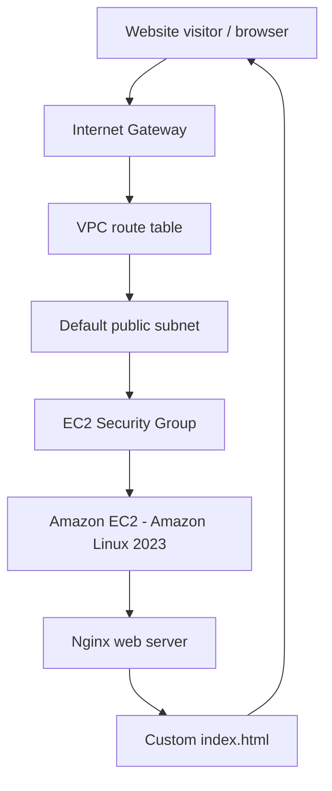

# Project 03 — EC2 Linux Web Server on AWS

**Project type:** Hands-on AWS implementation  
**Status:** EC2 deployment and HTTP test completed; evidence, supporting documentation, and resource cleanup in progress  
**Date started:** 14 November 2026  
**Region:** US East (N. Virginia) — `us-east-1`

## 1. Project Overview

This project demonstrates how to provision and operate a Linux-based web server on Amazon EC2.

An Amazon Linux 2023 instance was launched in a default VPC subnet, secured with an EC2 security group, and configured to run Nginx. A custom static HTML page was deployed and made accessible through the instance's automatically assigned public IPv4 address.

The purpose of this project is to gain practical experience with basic EC2 provisioning, network access, EBS storage, SSH connectivity, and web-server deployment.

## 2. Project Objectives

- Launch and inspect an Amazon EC2 Linux instance.
- Select an AMI and an appropriate instance type.
- Configure a security group with restricted SSH access and public HTTP access.
- Use an encrypted EBS root volume.
- Connect to Amazon Linux using SSH and a key pair.
- Install, start, and enable Nginx.
- Deploy a custom HTML page.
- Verify the web server locally and through a browser.
- Record implementation evidence and clean up billable resources after the lab.

## 3. AWS Services and Technologies

| Service / Technology | Purpose |
|---|---|
| Amazon EC2 | Hosts the Linux virtual server. |
| Amazon VPC | Provides the virtual network for the instance. |
| Amazon VPC Subnet | Places the instance in an Availability Zone. |
| Internet Gateway | Provides the VPC with a route to the public internet. |
| Route Table | Routes non-local IPv4 traffic through the Internet Gateway. |
| Security Group | Controls inbound and outbound instance traffic. |
| Amazon EBS | Provides the instance's persistent root volume. |
| AWS KMS managed key (`aws/ebs`) | Encrypts the EBS volume. |
| Amazon Linux 2023 | Operating system used by the instance. |
| SSH | Provides secure command-line administration. |
| Nginx | Serves the static HTML page over HTTP. |
| curl | Verifies the local HTTP response. |

## 4. Implemented Architecture



**Request path:** Browser → Internet Gateway → VPC route table → public subnet → Security Group → EC2 → Nginx → HTML response.

The security group allows:
- **SSH (TCP 22):** only from the administrator's public IP address (/32).
- **HTTP (TCP 80):** from the internet (`0.0.0.0/0`) so visitors can view the website.

The instance uses an automatically assigned public IPv4 address; no Elastic IP was allocated.

## 5. EC2 Configuration

| Setting | Implemented value |
|---|---|
| Instance name | `project-02-ec2-linux-web-server` |
| Instance type | `t3.micro` |
| vCPU / memory | 2 vCPU / 1 GiB |
| AMI | Amazon Linux 2023, x86_64 |
| Region | `us-east-1` |
| VPC | Default VPC |
| Subnet | Default subnet in `us-east-1c` |
| Subnet IPv4 CIDR | `172.31.16.0/20` |
| VPC IPv4 CIDR | `172.31.0.0/16` |
| Public IPv4 | Automatically assigned |
| EBS root volume | 8 GiB, General Purpose SSD (`gp3`) |
| EBS encryption | Enabled with AWS managed key `aws/ebs` |
| Delete on termination | Enabled |
| Purchasing option | On-Demand |
| CPU credit option | Standard |
| Detailed CloudWatch monitoring | Disabled |
| Instance metadata | IMDSv2 required |

The instance name is an AWS resource tag. The project folder is named `project-03-ec2-linux-web-server` to preserve the repository's existing project numbering.

## 6. Implementation and Validation

The following implementation steps were completed:

1. Selected the `us-east-1` Region.
2. Launched one `t3.micro` instance using Amazon Linux 2023.
3. Created a dedicated security group named `project-02-ec2-web-sg`.
4. Restricted SSH access to the administrator's public IP and allowed HTTP on TCP port 80.
5. Configured an 8 GiB encrypted gp3 EBS root volume.
6. Created and used an EC2 key pair to connect from Windows PowerShell over SSH.
7. Verified the operating system and login user.
8. Installed Nginx using the Amazon Linux package manager.
9. Started Nginx and enabled it to start automatically after reboot.
10. Replaced the default Nginx page with a custom `index.html`.
11. Opened the site through the instance's public IPv4 address.
12. Verified the local HTTP response using `curl -I http://localhost`.

### Test result

The local HTTP header test returned:

```text
HTTP/1.1 200 OK
Server: nginx/1.30.6
Content-Type: text/html
```

The custom page was also successfully displayed in a browser through the instance's public IPv4 address.

## 7. Project Files

Planned repository structure:

```text
project-03-ec2-linux-web-server/
├── README.md
├── architecture/
│   └── architecture.md
├── documentation/
│   ├── 01-ec2-configuration.md
│   ├── 02-network-and-security.md
│   ├── 03-deployment-and-testing.md
│   └── 04-cost-and-cleanup.md
└── screenshots/
    └── README.md
```

Supporting documentation and screenshot evidence will be added as they are prepared.

## 8. Cost and Security Notes

This lab uses On-Demand EC2 capacity and billable resources. Charges may apply for:
- EC2 instance runtime.
- The EBS volume while it exists, including when the instance is stopped.
- The automatically assigned public IPv4 address while allocated.
- Data transfer and other applicable usage.

The instance should not be left running when it is no longer needed. Before ending the lab, review the current AWS billing information and terminate the instance. Confirm that the EBS root volume is deleted as configured, and check that no additional billable resources remain.

Security precautions:
- Never upload the private `.pem` key, credentials, or access tokens to GitHub.
- Keep SSH restricted to a trusted source IP.
- HTTP is used for this basic lab; HTTPS and certificate configuration are outside the current project scope.
- Do not publish account identifiers or sensitive console information in screenshots.

## 9. Remaining Work

- [ ] Add the architecture diagram to `architecture/architecture.md`.
- [ ] Add concise implementation notes to the `documentation/` directory.
- [ ] Add the browser screenshot to `screenshots/`.
- [ ] Add an EC2 configuration / status screenshot.
- [ ] Update the project index in `04-cloud-projects/README.md`.
- [ ] Review AWS billing and terminate the EC2 instance when evidence collection is complete.
- [ ] Verify that no billable lab resources remain.

## 10. Project Status

The EC2 instance was successfully deployed and the custom Nginx website was verified. The project remains **in progress** until its documentation and evidence are committed and the AWS lab resources are safely cleaned up.
