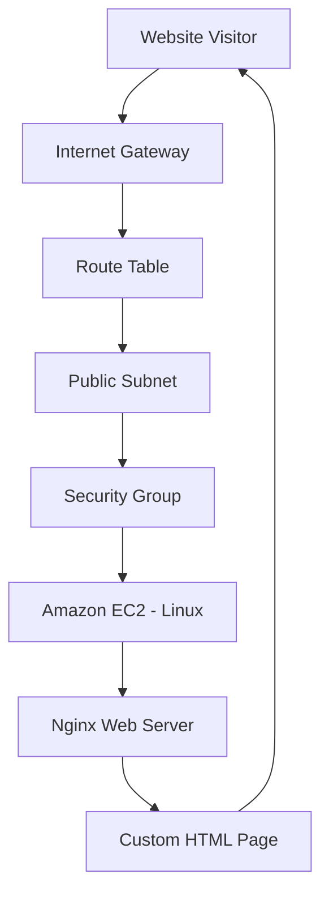
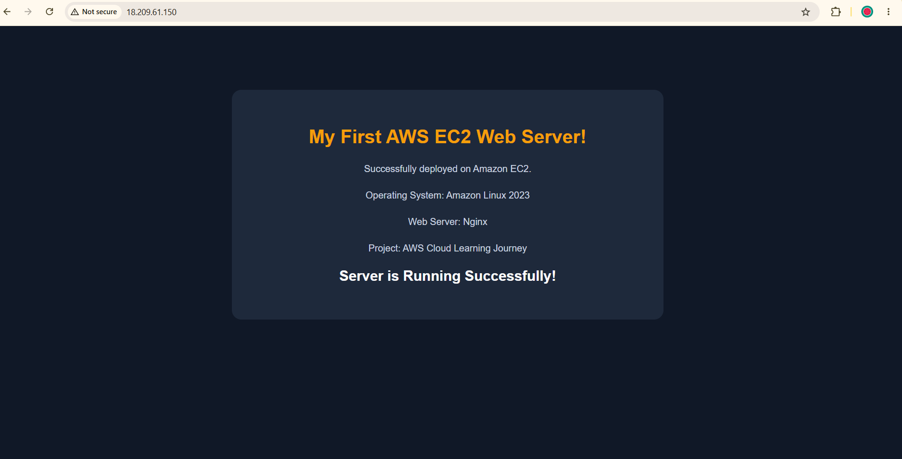
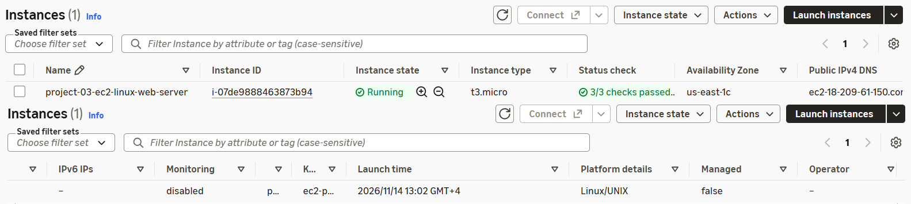
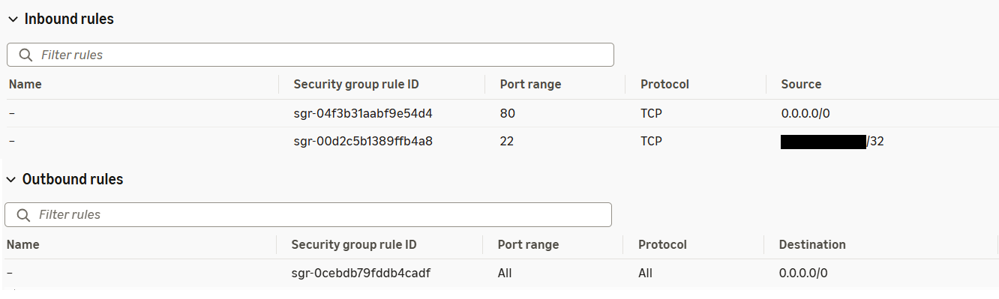
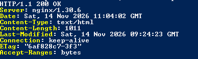

# Project 03 — EC2 Linux Web Server on AWS

**Project Type:** Hands-on AWS Implementation  
**Status:** Deployment and testing completed; documentation and cleanup in progress  
**Start Date:** 14 November 2026  
**AWS Region:** US East (N. Virginia) — `us-east-1`

## 1. Project Overview

This project demonstrates how to deploy and operate a Linux-based web server using Amazon EC2.

An Amazon Linux 2023 instance was provisioned, secured with an EC2 Security Group, and configured to run Nginx.

A custom static HTML page was deployed and successfully accessed through the instance's public IPv4 address.

The project provides hands-on experience with EC2 provisioning, networking, security, EBS storage, SSH connectivity, and basic web server deployment.

## 2. Project Objectives

- Provision an Amazon EC2 Linux instance.
- Configure networking and Security Group rules.
- Deploy an encrypted EBS root volume.
- Establish secure SSH connectivity.
- Install and configure Nginx.
- Deploy a custom HTML web page.
- Test HTTP connectivity and server responses.
- Document the implementation and results.
- Review AWS costs and clean up resources.

## 3. AWS Services and Technologies

| Service / Technology | Purpose |
|---|---|
| Amazon EC2 | Linux virtual server |
| Amazon VPC | Virtual networking |
| VPC Subnet | Network placement |
| Internet Gateway | Internet connectivity |
| Route Table | Network traffic routing |
| Security Group | Instance-level firewall |
| Amazon EBS | Persistent root storage |
| AWS KMS | EBS volume encryption |
| Amazon Linux 2023 | Operating system |
| SSH | Remote server access |
| Nginx | Web server |
| HTML | Static website content |
| curl | HTTP response testing |

## 4. Architecture



### Network Configuration

- VPC CIDR: `172.31.0.0/16`
- Subnet CIDR: `172.31.16.0/20`
- Availability Zone: `us-east-1c`
- Internet Gateway: Attached
- Route: `0.0.0.0/0` to Internet Gateway

### Security Group Rules

| Type | Protocol | Port | Source |
|---|---|---|---|
| SSH | TCP | 22 | Administrator's IP (/32) |
| HTTP | TCP | 80 | `0.0.0.0/0` |
| Outbound | All | All | `0.0.0.0/0` |

SSH access was restricted to a specific public IP address rather than being exposed to the entire internet.

## 5. EC2 Instance Configuration

| Setting | Value |
|---|---|
| Instance Name | `project-03-ec2-linux-web-server` |
| Instance Type | `t3.micro` |
| vCPU | 2 |
| Memory | 1 GiB |
| AMI | Amazon Linux 2023 |
| Architecture | x86_64 |
| Region | `us-east-1` |
| VPC | Default VPC |
| Subnet | Default Subnet |
| Root Volume | 8 GiB |
| Volume Type | gp3 |
| Encryption | Enabled |
| KMS Key | AWS Managed Key (`aws/ebs`) |
| Delete on Termination | Enabled |
| Purchasing Model | On-Demand |
| CPU Credit Mode | Standard |
| Instance Metadata | IMDSv2 Required |

## 6. Implementation Steps

1. Selected the AWS Region.
2. Launched an EC2 instance using Amazon Linux 2023.
3. Created a dedicated Security Group.
4. Configured restricted SSH and public HTTP access.
5. Configured an encrypted 8 GiB gp3 EBS root volume.
6. Created an EC2 Key Pair.
7. Connected to the instance through SSH using Windows PowerShell.
8. Verified the operating system and instance hostname.
9. Installed Nginx using the DNF package manager.
10. Started and enabled the Nginx service.
11. Created a custom `index.html` page.
12. Verified the website through the instance's public IPv4 address.
13. Tested the local HTTP response using curl.

## 7. Testing and Results

### Web Server Status

Nginx was successfully installed and is running.

The service was configured to start automatically after instance reboot.

### HTTP Response Test

Command:

```bash
curl -I http://localhost
```

Result:

```text
HTTP/1.1 200 OK
Server: nginx/1.30.6
Content-Type: text/html
```

### Deployment Result

The custom website was successfully displayed through the EC2 public IPv4 address.

The deployment and HTTP tests were completed successfully.

## 8. Screenshot Evidence

### 01 — Web Server Running



### 02 — EC2 Instance Details



### 03 — Security Group Rules



### 04 — HTTP Response Test



Additional screenshot documentation is available in the [screenshots directory](./screenshots/).

## 9. Cost and Security Considerations

The project uses On-Demand EC2 capacity and billable AWS resources.

Potential charges include:

- EC2 instance runtime.
- EBS volume storage.
- Public IPv4 address allocation.
- Applicable data transfer.

Security practices:

- SSH access is restricted to a trusted IP address.
- EBS encryption is enabled.
- IMDSv2 is required.
- Private keys and credentials are not included in the repository.
- HTTP is used for this basic learning project; HTTPS is outside the current scope.

The EC2 instance must be terminated after evidence collection and documentation are completed.

## 10. Remaining Tasks

- [x] EC2 instance deployed.
- [x] Security Group configured.
- [x] EBS encryption enabled.
- [x] SSH connection established.
- [x] Nginx installed and running.
- [x] Custom HTML page deployed.
- [x] HTTP response verified.
- [x] Four implementation screenshots uploaded.
- [ ] Create a dedicated architecture document.
- [ ] Complete supporting technical documentation.
- [ ] Review final AWS costs.
- [ ] Terminate the EC2 instance and verify resource cleanup.

## 11. Project Status

The Linux web server has been successfully deployed and tested on Amazon EC2.

The remaining work focuses on technical documentation, architecture evidence, and safe AWS resource cleanup.

This project is part of my ongoing AWS Cloud and Solutions Architecture learning journey.
