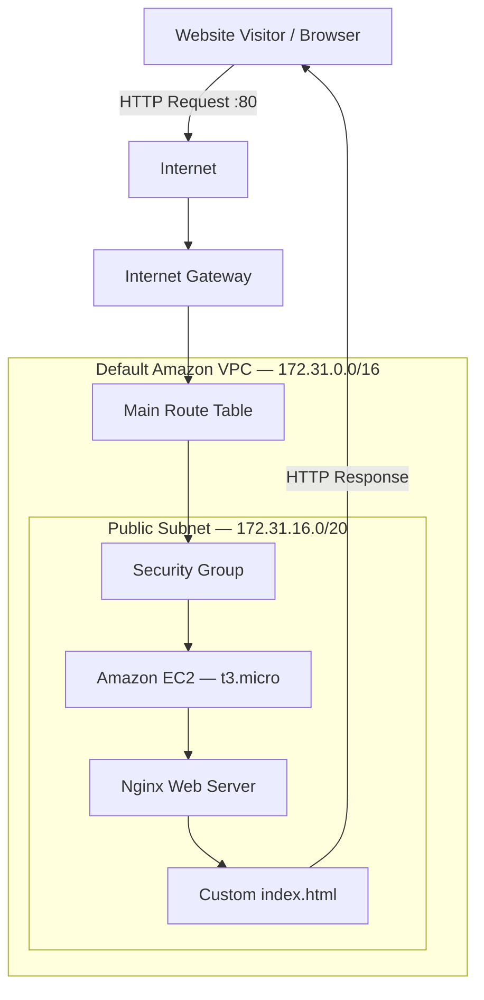

# Architecture — EC2 Linux Web Server

## 1. Architecture Overview

This project uses Amazon EC2 to host a Linux-based web server.

An Amazon Linux 2023 instance runs Nginx and serves a custom static HTML page to website visitors over HTTP.

The instance is deployed in a public subnet within the default Amazon VPC.

## 2. Architecture Diagram



The diagram represents the conceptual request path. The Internet Gateway is attached to the VPC, while the route table determines the route to the gateway.

## 3. Network Architecture

| Component | Configuration |
|---|---|
| AWS Region | us-east-1 |
| VPC | Default VPC |
| VPC CIDR | 172.31.0.0/16 |
| Subnet | Default public subnet |
| Subnet CIDR | 172.31.16.0/20 |
| Availability Zone | us-east-1c |
| Internet Gateway | Attached to VPC |
| Public IPv4 | Automatically assigned |
| Route | 0.0.0.0/0 → Internet Gateway |
| Local Route | 172.31.0.0/16 → local |

## 4. Security Architecture

The EC2 instance is protected by a dedicated Security Group.

### Inbound Rules

| Type | Protocol | Port | Source |
|---|---|---|---|
| SSH | TCP | 22 | Administrator's IP (/32) |
| HTTP | TCP | 80 | 0.0.0.0/0 |

### Outbound Rules

All outbound traffic is allowed.

### Additional Security Settings

- EBS root volume encryption is enabled.
- AWS managed KMS key (aws/ebs) is used.
- SSH access is restricted to a trusted public IP.
- IMDSv2 is required.
- The private SSH key is stored locally and is not included in the repository.

## 5. Compute and Storage

### EC2 Configuration

| Setting | Value |
|---|---|
| Instance Type | t3.micro |
| Operating System | Amazon Linux 2023 |
| Architecture | x86_64 |
| vCPU | 2 |
| Memory | 1 GiB |
| Purchasing Model | On-Demand |
| CPU Credit Mode | Standard |

### EBS Configuration

| Setting | Value |
|---|---|
| Volume Type | gp3 |
| Volume Size | 8 GiB |
| Encryption | Enabled |
| KMS Key | aws/ebs |
| Delete on Termination | Yes |

## 6. Application Layer

Nginx is installed on the Amazon Linux instance and serves the website files.

| Component | Configuration |
|---|---|
| Web Server | Nginx 1.30.6 |
| HTTP Port | 80 |
| Document Root | /usr/share/nginx/html/ |
| Main Page | index.html |
| Application Type | Static HTML |

The custom website is stored in the Nginx document root and is returned when visitors access the EC2 public IPv4 address.

## 7. Request Flow

1. A visitor opens the website using the EC2 public IPv4 address.
2. The request reaches the VPC through the Internet Gateway.
3. The VPC route table provides the route to the Internet Gateway.
4. The Security Group permits inbound HTTP traffic on TCP port 80.
5. The EC2 instance receives the request.
6. Nginx processes the request and reads index.html.
7. The HTML response is returned to the visitor.

## 8. Validation

The deployment was verified using two methods:

**Browser Test**

The custom website was successfully accessed through the EC2 public IPv4 address.

**Local HTTP Test**

```bash
curl -I http://localhost
```

Expected and observed response:

```text
HTTP/1.1 200 OK
Server: nginx/1.30.6
Content-Type: text/html
```

## 9. Architecture Scope and Limitations

This project demonstrates a basic single-instance web hosting architecture.

The following components are intentionally outside the project scope:

- Application Load Balancer
- Auto Scaling Group
- Multi-AZ deployment
- NAT Gateway
- Amazon RDS
- HTTPS certificate configuration

The architecture is designed for learning and demonstration, not production-grade high availability.

## 10. Cost Considerations

The architecture uses On-Demand EC2 capacity, an EBS volume, and an automatically assigned public IPv4 address.

These resources may incur charges while allocated or running.

The instance and associated billable resources must be reviewed and cleaned up after the project is completed.

